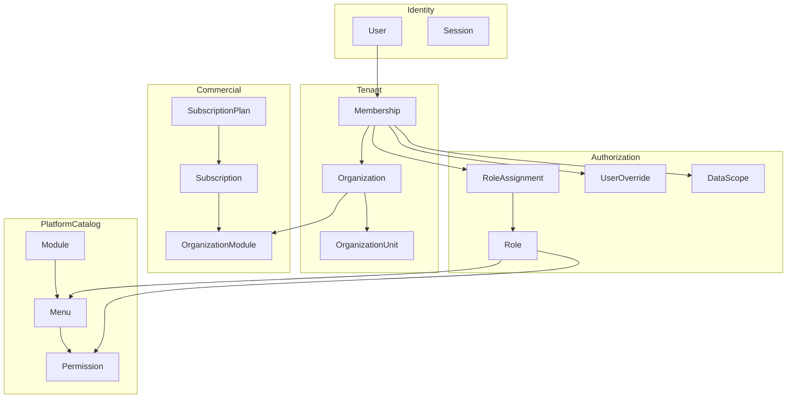
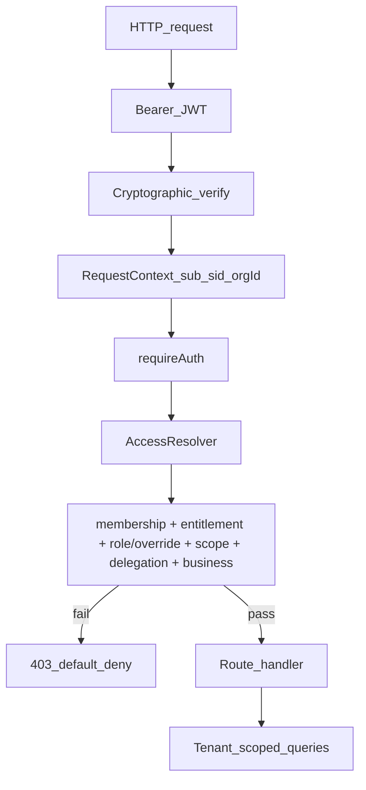

<!--
╔══════════════════════════════════════════════════════════════╗
║ AZES COMPANY
║ File: docs/access_control/ACCESS_CONTROL_ARCHITECTURE.md
║ Author: AZES_COMPANY
║ Created: 2026-10-27
║ Updated: 2026-10-27
║ Purpose: Target access-control architecture for AZES (planning)
║ Layer: docs
╚══════════════════════════════════════════════════════════════╝
-->

# Access Control Architecture (Target)

**Status:** Planning target — implementation follows approved phases and `DECISIONS.md`.  
**Phase 01 (2026-10-27):** AC-D01…AC-D08 locked as **option A** — see [`DECISIONS.md`](./DECISIONS.md).  
**Source inputs (read-only):** [`AccessControlArixtektura.md`](../../AccessControlArixtektura.md),
[`CURRENT_STATE_AUDIT.md`](./CURRENT_STATE_AUDIT.md), [`TAGET.MD`](../../TAGET.MD).  
**Non-goal:** New parallel auth package or rewrite of working M1–M5.0-lite foundations.

---

## 1. Principles

1. **Backend owns authorization.** Frontend hides/disables for UX only.
2. **Default deny.** Missing, failed, or unknown policy → deny.
3. **Menu ≠ permission.** Nav visibility never authorizes mutations.
4. **Tenant isolation** at API and query layers.
5. **Organization ≠ Organization Unit.** Tenant vs in-tenant structure.
6. **Adapt in place:** `apps/api`, `@azes/auth`, OpenAPI/`@azes/api` — no `@azes/role_system`.
7. **Token = identity + session context**, not a long-lived permission dump.

---

## 2. Domain boundaries

| Entity                     | Meaning                                                                 |
| -------------------------- | ----------------------------------------------------------------------- |
| User                       | Global person account; may join many orgs                               |
| Organization               | Tenant / customer boundary                                              |
| Organization Unit          | Branch, department, team **inside** one org                             |
| Membership                 | User↔Org link; status; active pointer via session/`users.org_id`        |
| Module                     | Platform capability (CRM, Finance, …) registered once                   |
| Menu                       | Navigation node under a module (not a security boundary)                |
| Permission                 | Action code e.g. `crm.customers.read`, `finance.invoices.post`          |
| Role                       | Reusable menu + permission bundle (platform template and/or org-scoped) |
| Scope                      | Org / unit / own / record boundary for permitted actions                |
| Subscription / entitlement | Whether the org may use a module                                        |

---

## 3. Authority levels (logical)

These are **authority profiles**, not a mandatory single DB enum:

| Level        | Intent                                                     | Current mapping (audit)                                                   |
| ------------ | ---------------------------------------------------------- | ------------------------------------------------------------------------- |
| SuperAdmin   | Protected platform owner                                   | `superAdmin` EXISTS                                                       |
| GeneralAdmin | Platform ops without automatic tenant business-data bypass | MISSING as named role — see AC-D01                                        |
| Admin        | Org administrator                                          | `orgAdmin`                                                                |
| Delegated    | Branch/dept managers via org roles + unit scope            | Units + subtree + unified resolver EXISTS (Phase 03/05/06); UI → Phase 07 |
| User         | Assigned modules/menus/perms/scope only                    | `member` + profiles PARTIAL                                               |
| LMS roles    | Instructor/Student/Guest for Academy domain                | Keep separate from ERP grants                                             |

LMS roles must not silently grant ERP module administration.

---

## 4. Request authorization flow

**Request context** (from verified token, not client body):

- `userId` (`sub`)
- `sessionId` (`sid`)
- active `orgId` when applicable
- roles claim for bootstrap only — **not sole proof** of current rights

**Per protected action:**

1. Authenticated + session valid
2. User active
3. Membership active for target org (if org-owned)
4. Org active / subscription policy
5. Module entitled + enabled (if module-bound)
6. Effective permission includes action
7. Scope allows target rows
8. Delegation ceiling (for admin/grant APIs)

---

## 5. Effective Access Resolver

Conceptual formula:

`Effective Access = Identity ∩ Membership ∩ Tenant ∩ Entitlement ∩ Role/Menu ∩ Permission ∩ Overrides ∩ Scope ∩ Business Policy`

Implementation home (**AC-D06 A DONE**): `apps/api/src/access/effectiveAccess.ts`.
`menu/effectiveAccess.ts` is a compatibility wrap only (no second policy).

Incorporates (Phase 06):

- `role_menus` + `menu_permissions`
- `organization_modules` entitlement ∩ subscription
- `user_menus` / `user_menu_permissions` (CRUD → codes)
- static LMS baseline only where still required
- `data_scope` summary on `/me` (`org` / `own` / `subtree`)
- explicit deny / restriction precedence (AC-D03 mapper)

`requirePermission` and `GET /me` share `resolveEffectiveAccess`.
Rollback: `ACCESS_RESOLVER_MODE=legacy`.

---

## 6. Menu vs permission

| Concern                        | Owner                                                   |
| ------------------------------ | ------------------------------------------------------- |
| What appears in AdminShell nav | Backend effective menu tree                             |
| What API mutations are allowed | Permission + scope checks per route                     |
| CRUD flags on user access UI   | Mapped to permission codes; not a second security model |

When a new menu is registered: nav may appear for eligible admins per policy;
**sensitive permissions are not auto-granted** to all existing users.

---

## 7. Modules & subscriptions

Sequence (must all pass):

1. Module in platform registry
2. Subscription/entitlement allows module
3. Org module assignment enabled
4. User role/override grants permission
5. Scope allows data

Target behaviors to specify in Phase 04 (not implemented yet): expiry, grace, read-only,
suspension, historical data retention (disable ≠ delete).

Current lite: `subscriptionStatus` `active`|`blocked` + `trialEndsAt`.

---

## 8. Token & session (target posture)

Reuse existing AZES auth:

- Short-lived access JWT
- Refresh rotation + reuse detection (already Phase 2E)
- Logout / session revoke
- Live server authz for permission changes (already M1.6 pattern)

**APPROVED (AC-D05 A):** keep `sub`, `sid`, `orgId`, `roles` as trusted request context;
JWT `permissions[]` is compat-only (still emitted; not authoritative); live server
authz via `effectiveCan`; JS-readable access cookie XSS documented in PHASE-2B —
storage redesign (HttpOnly/BFF) deferred.

**PROPOSED (AC-D04):** extend `GET /api/v1/me` with modules / scope summary / `accessVersion`
before inventing a separate `/me/access` (can alias later).

---

## 9. Frontend consumption

- Render only returned nav
- `checkPermission` for button enablement only
- Invalidate access cache on org switch, role/menu/access mutations, logout
- Use `@azes/ui-web` + existing admin feature architecture
- Never invent endpoints or permission codes not in OpenAPI

See [ui/UI_PLAN.md](./ui/UI_PLAN.md).

---

## 10. Audit

Privileged actions emit `audit_logs` (actor, action, target, org, timestamp, non-sensitive meta).
Never log tokens or passwords.

---

## 11. Relation to phases

Architecture is realized through [phases/](./phases/) after [DECISIONS.md](./DECISIONS.md)
approvals. This file does not authorize schema or API changes by itself.
