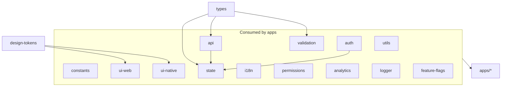

<!--
╔══════════════════════════════════════════════════════════════╗
║ AZES COMPANY
║ File: docs/architecture/dependency-graph.md
║ Author: AZES_COMPANY
║ Created: 2026-08-22
║ Updated: 2026-09-29
║ Purpose: Allowed and forbidden dependency directions
║ Layer: docs
╚══════════════════════════════════════════════════════════════╝
-->

# Dependency Graph

The dependency graph is directed and acyclic. Enforce it with ESLint import boundaries
(`tooling/eslint`) where practical, and in code review otherwise.

## Allowed direction

## Rules

- `apps → packages`: allowed.
- `apps → apps`: FORBIDDEN.
- `ui-web` may depend on `design-tokens`, React, `@mui/material`, and Emotion.
  It must not depend on `@mui/material-nextjs`, `api`, `state`, `auth`, or business domains.
- `ui-native` may depend on `design-tokens`, React Native, and RN primitives.
  FORBIDDEN: MUI, `api`, `state` (Redux), `auth`, business domains.
- `utils | constants | types`: framework-agnostic. FORBIDDEN: `react`, `react-native`, `api`.
- `api/generated`: FORBIDDEN to import manually maintained business logic.
- No deep imports: import only from a package's public entry point (`@azes/<pkg>`), never
  `@azes/<pkg>/src/...`.

## Enforcement

- ESLint `no-restricted-imports` / boundary plugin patterns per layer.
- Package `exports` maps prevent internal-path imports.
- CI runs the boundary lint as a quality gate (Phase 2+).
- Verified end-to-end in Phase 12 via `pnpm architecture:verify` (see
  [verification-signoff.md](verification-signoff.md)).

See [../development/dependency-rules.md](../development/dependency-rules.md) for the practical
"can I import X from Y?" table.
