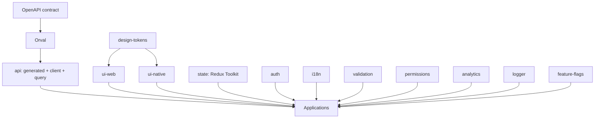

<!--
╔══════════════════════════════════════════════════════════════╗
║ AZES COMPANY
║ File: docs/architecture/overview.md
║ Author: AZES_COMPANY
║ Created: 2026-08-22
║ Updated: 2026-08-22
║ Purpose: High-level architecture overview and guiding principles
║ Layer: docs
╚══════════════════════════════════════════════════════════════╝
-->

# Architecture Overview

## Mission

AZES is an enterprise **frontend** monorepo hosting multiple web and mobile applications that
share a stable platform layer. The backend is external; the frontend consumes it through
OpenAPI contracts.

## Guiding principles

1. **Shared stable capabilities belong in `packages/`. Product-specific business logic belongs
   in `apps/` (inside `features/`).** Do not create a shared-code dumping ground and do not
   prematurely abstract.
2. **Controlled complexity.** Build the smallest architecture that safely supports several years
   of growth. Avoid micro-packages, duplicate providers, and universal abstractions.
3. **Clear state ownership.** Server state → TanStack Query. Client/global state → Redux Toolkit.
4. **Design language is centralized.** `design-tokens` is the single source of truth and is
   framework-agnostic (no React).
5. **Web and Native UI are separate.** `ui-web` and `ui-native` are distinct packages sharing
   only design tokens.
6. **Contracts are generated.** OpenAPI → Orval → typed client. Generated code is never edited.
7. **Encapsulation.** Packages expose a public API via `exports`. No deep imports.
8. **Decoupled providers.** Analytics, logging, feature flags, and auth providers sit behind
   abstractions so they can be replaced without touching app code.

## System layers



## Applications

- Web (React + TS, Vite): `account`, `admin`, `agent-platform`, `azes-ui`
- Web (React + TS, Next.js App Router): `realestate`, `agent-site`
- Mobile (React Native, Expo): `mobile-account`, `mobile-agent`, `mobile-realestate`

## File header policy (summary)

Every comment-supporting file starts with the AZES header, using syntax valid for the file type:

```text
╔══════════════════════════════════════════════════════════════╗
║ AZES COMPANY
║ File: <filename>
║ Author: AZES_COMPANY
║ Created: <YYYY-MM-DD>
║ Updated: <YYYY-MM-DD>
║ Purpose: <short description>
║ Layer: <app|package|tooling|docs>
╚══════════════════════════════════════════════════════════════╝
```

- TS/TSX/CSS/JS → block comment. Markdown → HTML comment. YAML/shell → `#` lines.
- `.mdc` (Cursor rules) → header goes **after** the required frontmatter block.
- **Strict JSON has no comments** — do not insert any. Document the file's purpose in a sibling
  `*.md` or via an agreed `_meta`/`$schema` key where the schema allows it.
- **Exempt:** lockfiles, generated code, build output, caches, binaries. See
  `.cursor/rules/comment-header.mdc` and `.cursor/rules/api-generation.mdc`.

## Where to go next

- Repository structure: [repository-structure.md](repository-structure.md)
- Dependency graph: [dependency-graph.md](dependency-graph.md)
- Packages: [package-architecture.md](package-architecture.md)
- Applications: [application-architecture.md](application-architecture.md)
