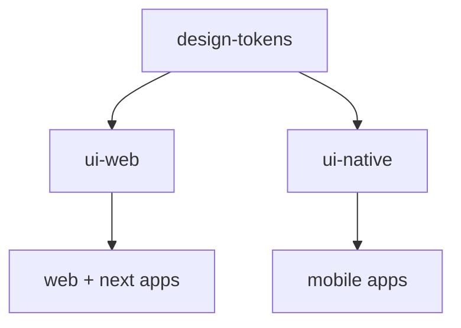

<!--
╔══════════════════════════════════════════════════════════════╗
║ AZES COMPANY
║ File: docs/architecture/ui-architecture.md
║ Author: AZES_COMPANY
║ Created: 2026-08-22
║ Updated: 2026-10-04
║ Purpose: Web vs Native UI strategy and design-token layering
║ Layer: docs
╚══════════════════════════════════════════════════════════════╝
-->

# UI Architecture

## Principle: separate web and native, share the design language



Do NOT build one universal UI package that tries to be web and native at once. Component
implementations are platform-specific; only the **design language** (tokens) is shared.

## Layering

```text
Headless / accessibility primitives
        -> AZES design system (ui-web / ui-native)
        -> Application UI
```

## Web (`ui-web`)

- Theme engine is Material UI v9 inside `@azes/ui-web` (`createAzesTheme`, CSS variables,
  light/dark color schemes). See [ADR-009](../decisions/ADR-009-mui-web-theme.md) and
  [../styles/02-architecture.md](../styles/02-architecture.md).
- AZES components wrap that engine and apply `@azes/design-tokens`. Apps consume
  `@azes/ui-web` and its subpaths (`/settings`, `/navigation`, `/layout`, `/icons`,
  `/data-grid`, `/charts`, `/forms`) per ADR-010 to ADR-016. Full docs:
  [../styles/README.md](../styles/README.md).
- Apps must not import `@mui/material` components, Radix, or Ant. Documented exceptions:
  `apps/realestate` may import `@mui/material-nextjs` and `InitColorSchemeScript`;
  `apps/azes-ui` may deep-import `@mui/icons-material`.
- Legacy BEM CSS and the old `ThemeProvider` were removed in the deprecation step recorded in
  [../styles/legacy/migration/13-deprecation.md](../styles/legacy/migration/13-deprecation.md).
  The UI platform phases are in [../styles/17-migration.md](../styles/17-migration.md). Cross-app
  integration evidence (v1): [../styles/legacy/CROSS-APP.md](../styles/legacy/CROSS-APP.md).

## Native (`ui-native`)

- Built on React Native primitives + the AZES design system.
- Styling: token-driven `StyleSheet`.
- Lightweight by default; avoid heavy component libraries (NativeBase, etc.) unless there is a
  deliberate, documented architectural reason.

## Design tokens

- `design-tokens` is framework-agnostic (no React). It emits:
  - a TypeScript object for JS/RN consumption,
  - CSS custom properties for web/Next.js.
- Token categories: colors, typography, font sizes, font weights, spacing, radius,
  shadow/elevation, breakpoints, z-index, animation durations, motion, sizing, semantic colors,
  and light/dark theme foundations.
- See [../decisions/ADR-008-design-tokens.md](../decisions/ADR-008-design-tokens.md).

## Replaceability guarantee

Applications depend only on `@azes/ui-web` / `@azes/ui-native`. The underlying primitive library
is an implementation detail of those packages. The web/native split is
[ADR-004](../decisions/ADR-004-ui-architecture.md). The web theme engine is
[ADR-009](../decisions/ADR-009-mui-web-theme.md).
