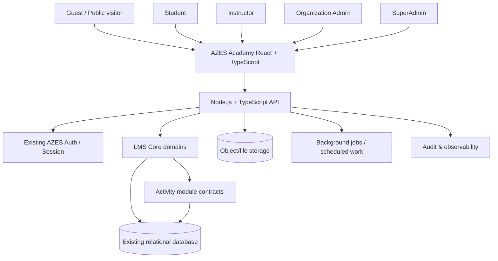
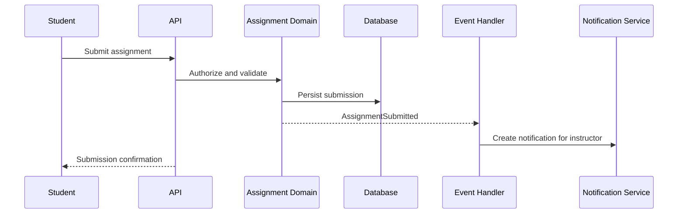

from pathlib import Path

content = r"""# AZES Academy — Moodle prinsiplərinə əsaslanan LMS arxitekturası

**Sənəd növü:** Arxitektura təklifi və mərhələli icra planı  
**Status:** Planlaşdırma üçün ilkin versiya — repo auditi ilə təsdiqlənməlidir  
**Məhsul:** AZES Academy  
**Hədəf:** Moodle-un LMS arxitektura prinsiplərini AZES-in mövcud React + TypeScript, Node.js + TypeScript, MUI 9 və mövcud dizayn sistemi ilə tətbiq etmək  
**Əsas qayda:** Bu sənəd planlaşdırma üçündür. Repo auditi və ayrıca təsdiq olmadan tətbiq kodu, verilənlər bazası, API, paketlər və mövcud UI dəyişdirilməməlidir.

---

## 1. Məqsəd və sərhədlər

AZES Academy-ni təkcə kurs siyahısı olan sayt kimi deyil, rolları, kurs məzmunu, qeydiyyat, qiymətləndirmə, tamamlanma, analitika və genişlənə bilən fəaliyyət modulları olan tam LMS (Learning Management System) kimi qurmaq.

Moodle-un PHP kodunu kopyalamaq nəzərdə tutulmur. Məqsəd onun arxitektura ideyalarını — core platform, kontekst əsaslı icazələr, kurs strukturu, fəaliyyət modulları, plugin müqavilələri, completion, gradebook və genişlənmə nöqtələrini — AZES-in mövcud texnologiyaları ilə yenidən modelləşdirməkdir.

### 1.1 Hədəflər

- Mövcud AZES monorepo və texnologiya sərhədlərini qorumaq.
- React + TypeScript frontend və Node.js + TypeScript backend istifadə etmək.
- MUI 9, mövcud `@azes/*` paketləri və dizayn tokenlərindən istifadə etmək.
- SuperAdmin, OrgAdmin, Instructor, Student və Guest rollarını server tərəfində yoxlamaq.
- Kurslar, proqramlar, bölmələr, dərslər, resurslar, testlər, tapşırıqlar və qiymətləri əlaqəli model kimi idarə etmək.
- İlk versiyanı modullar əlavə oluna bilən, lakin başlanğıcda idarə edilə bilən monolit kimi qurmaq.
- Hər funksiyanı hazırkı repo reallığı ilə yoxlamaq; mövcud olmayan API və komponentləri mövcud kimi göstərməmək.

### 1.2 Hədəfdən kənar

- Moodle-un PHP tətbiqini AZES backend-inə birbaşa köçürmək.
- İlk gündən mikroservislərə bölmək.
- LMS üçün ayrıca, mövcud AZES shell-dən fərqli dizayn sistemi yaratmaq.
- Real repo auditi olmadan endpoint, cədvəl, komponent və ya icazənin mövcud olduğunu iddia etmək.
- İlk mərhələdə bütün Moodle modullarını eyni anda yaratmaq.

---

## 2. Arxitektura prinsipləri

1. **Core + modul müqavilələri:** İstifadəçi, kurs, qeydiyyat, icazə və audit kimi fundamental imkanlar LMS core-a aiddir. Quiz və Assignment kimi tədris fəaliyyətləri ayrıca modul müqavilələri ilə əlavə olunur.
2. **Server-side authorization:** UI-da düyməni gizlətmək icazə nəzarəti sayılmır. Hər endpoint tenant, kontekst və capability yoxlaması etməlidir.
3. **Tenant isolation:** Təşkilat məlumatı yalnız həmin təşkilatın səlahiyyətli istifadəçilərinə görünür. SuperAdmin üçün ayrıca qlobal səlahiyyətlər müəyyən edilir.
4. **Domain sərhədləri:** Kurs, qeydiyyat, qiymət və completion fərqli məsuliyyətlərdir; bir cədvələ və ya komponentə yığılmamalıdır.
5. **API-first:** Frontend backend-in daxili implementasiyasına deyil, versiyalanmış API müqavilələrinə əsaslanır.
6. **Auditability:** Rol, qeydiyyat, qiymət, kurs statusu və platforma parametrlərindəki kritik dəyişikliklər izlənə bilməlidir.
7. **Accessibility:** Klaviatura ilə istifadə, fokus, kontrast, form label-ları və ekran oxuyucusu dəstəyi dizaynın bir hissəsidir.
8. **Progressive delivery:** Əvvəl bir kursun yaradılmasından tələbənin tamamlamasına qədər tam axın; sonra modulların genişləndirilməsi.
9. **Mövcud dizaynı qorumaq:** Sidebar, header, route shell və qlobal naviqasiya yenidən dizayn edilmir. Yalnız səhifə məzmunu və yeni LMS funksiyalarının ekranları mövcud sistemə uyğunlaşdırılır.
10. **Miqrasiya və uyğunluq:** Data model və API dəyişiklikləri geriyə uyğunluq, migration və rollback planı ilə edilməlidir.

---

## 3. Hədəf texnoloji baza

Aşağıdakı texnologiyalar ilkin hədəfdir; repo auditi mövcud faktları təsdiqləməlidir.

| Sahə         | Hədəf                                                                                         |
| ------------ | --------------------------------------------------------------------------------------------- |
| Monorepo     | Mövcud Turborepo + pnpm strukturu                                                             |
| Frontend     | React + TypeScript + Vite (`apps/academy`)                                                    |
| UI           | MUI 9 + mövcud AZES design tokens və `@azes/ui-web`                                           |
| Server state | Mövcud TanStack Query konvensiyaları                                                          |
| Client state | Mövcud Redux Toolkit yalnız həqiqətən client-state olduqda                                    |
| Backend      | Node.js + TypeScript; mövcud API strukturu ilə uyğunlaşdırılmalıdır                           |
| API          | Mövcud Hono/API konvensiyaları; OpenAPI/Orval varsa onlardan istifadə                         |
| Database     | Mövcud verilənlər bazası texnologiyası və migration sistemi; auditdən əvvəl yenisini seçməmək |
| Fayllar      | Mövcud storage adapteri; R2 yalnız repo və deployment planı təsdiqlədikdən sonra              |
| Test         | Mövcud unit, integration, e2e və architecture verify konvensiyaları                           |
| Telemetriya  | Mövcud logging/error-reporting konvensiyaları                                                 |

### 3.1 Backend yerləşdirmə qərarı

İlk texniki qərar repo auditi ilə verilməlidir:

- Əgər `apps/api` artıq AZES Academy üçün uyğun domain və route sərhədlərinə malikdirsə, LMS domain-ləri həmin tətbiqə ayrıca modul kimi əlavə etmək.
- Əgər `apps/api`-nin sərhədləri və deployment ehtiyacları ayrılıq tələb edirsə, ayrıca `apps/academy-api` təklifini ADR (Architecture Decision Record) ilə əsaslandırmaq.
- Sadəcə “təmiz görünməsi” üçün ikinci backend yaratmamaq.
- İlk versiyada mikroservis arxitekturasına keçməmək.

---

## 4. Sistem konteksti



**Diagram note:** Bu konseptual görünüşdür; faktiki servis və storage adları auditdən sonra dəqiqləşdirilməlidir.

---

## 5. Moodle prinsiplərinin AZES-ə uyğunlaşdırılması

| Moodle konsepti       | AZES-də qarşılığı                   | Qeyd                                                          |
| --------------------- | ----------------------------------- | ------------------------------------------------------------- |
| Site / system context | Platforma səviyyəsi                 | Yalnız SuperAdmin üçün qlobal parametrlər                     |
| Category context      | Kurs kateqoriyası / tədris sahəsi   | Təşkilat sərhədləri ilə uyğunlaşdırılmalıdır                  |
| Course context        | Kurs konteksti                      | Kursa aid icazə və resurslar                                  |
| Activity context      | Fəaliyyət konteksti                 | Quiz, Assignment və digər modullar                            |
| Roles + capabilities  | Role assignment + capability policy | Rol adı təkbaşına kifayət deyil; kontekst də vacibdir         |
| Course sections       | Kurs bölmələri / modulları          | Sıralama, görünürlük, şərtlər                                 |
| Activity modules      | Activity plugins                    | Vahid kontrakt və qeydiyyat mexanizmi                         |
| Resource modules      | Resource plugins                    | Fayl, link, səhifə və digər materiallar                       |
| Enrolment             | Kurs qeydiyyatı                     | Manual, təşkilat tərəfindən və gələcəkdə self-enrolment       |
| Gradebook             | Qiymət kitabçası                    | Fəaliyyət nəticələrini vahid qaydada birləşdirir              |
| Completion tracking   | Fəaliyyət və kurs tamamlanması      | Qaydalarla hesablanır, əl ilə status yazılmır                 |
| Competencies          | Bacarıqlar / kompetensiyalar        | Sonrakı mərhələdə                                             |
| Events / logs         | Domain events + audit log           | Tədris hadisələri ilə təhlükəsizlik auditini ayırmaq          |
| Plugins               | Modul müqavilələri                  | İlk gündən bütün Moodle plugin-lərini təkrarlamaq lazım deyil |

---

## 6. Domain arxitekturası

Tövsiyə edilən məntiqi domenlər:

1. **Identity & Access** — istifadəçi, təşkilat üzvlüyü, rol, capability və sessiya konteksti.
2. **Organization** — təşkilat, struktur, üzvlər və təşkilat parametrləri.
3. **Learning Catalog** — proqramlar, kurs kateqoriyaları, kurslar və ictimai görünürlük.
4. **Course Structure** — bölmələr, fəaliyyət sırası, resurslar və şərti açılma.
5. **Enrolment** — kursa qəbul, status, tarixlər və qeydiyyat mənbəyi.
6. **Activity Modules** — dərs, quiz, assignment və gələcək fəaliyyət tipləri.
7. **Assessment** — sual bankı, cəhdlər, təqdimatlar, qiymətləndirmə və feedback.
8. **Gradebook** — qiymət elementləri, çəkilər, yekun qiymət və görünürlük.
9. **Completion & Progress** — fəaliyyət və kursun tamamlanma qaydaları.
10. **Communication** — bildirişlər və elanlar.
11. **Reporting & Analytics** — iştirak, nəticələr, gecikmələr və progress.
12. **Files & Content** — fayl metadata-sı, giriş siyasəti və storage adapteri.
13. **Audit & Governance** — dəyişiklik tarixçəsi, saxlanma siyasəti və kritik hadisələr.
14. **Integration** — gələcəkdə LTI, OneRoster və digər xarici sistemlər.

Hər domain-in öz məsuliyyəti və public service/API sərhədi olmalıdır. Domain-lər bir-birinin daxili cədvəllərini birbaşa idarə etməməlidir; mümkün olduqda servis kontraktları ilə işləməlidir.

---

## 7. Məlumat modelinin ilkin layihəsi

Bu bölmə real schema deyil, ilkin domain modelidir. Adlar və əlaqələr mövcud schema auditindən sonra dəyişə bilər.

### 7.1 Əsas entity-lər

| Entity                   | Məqsəd                                 | Əsas sahələr — ilkin təklif                                           |
| ------------------------ | -------------------------------------- | --------------------------------------------------------------------- |
| `User`                   | İstifadəçi identikliyi                 | `id`, `displayName`, `email`, `status`                                |
| `Organization`           | Tenant/təşkilat                        | `id`, `name`, `status`, `settings`                                    |
| `OrganizationMembership` | İstifadəçinin təşkilat əlaqəsi         | `organizationId`, `userId`, `status`                                  |
| `RoleDefinition`         | Rol tərifi                             | `id`, `key`, `scopeType`                                              |
| `RoleAssignment`         | Kontekstdə rol təyini                  | `userId`, `roleKey`, `contextType`, `contextId`                       |
| `Capability`             | Əməliyyat icazəsi                      | `key`, `description`                                                  |
| `RoleCapability`         | Rolun capability xəritəsi              | `roleKey`, `capabilityKey`                                            |
| `LearningProgram`        | Tədris proqramı                        | `id`, `organizationId`, `title`, `status`                             |
| `CourseCategory`         | Kurs kateqoriyası                      | `id`, `organizationId`, `parentId`, `name`                            |
| `Course`                 | Kurs                                   | `id`, `organizationId`, `categoryId`, `title`, `status`, `visibility` |
| `CourseSection`          | Kurs bölməsi                           | `id`, `courseId`, `title`, `position`, `visibility`                   |
| `CourseActivity`         | Bölmədə fəaliyyət instansiyası         | `id`, `sectionId`, `moduleType`, `moduleInstanceId`, `position`       |
| `Resource`               | Kurs materialı                         | `id`, `organizationId`, `type`, `title`, `storageKey`                 |
| `Enrolment`              | Kurs qeydiyyatı                        | `id`, `courseId`, `userId`, `status`, `startsAt`, `endsAt`            |
| `ActivityAttempt`        | Quiz/aktivlik cəhdi                    | `id`, `activityId`, `userId`, `status`, `startedAt`, `submittedAt`    |
| `Submission`             | Tapşırıq təqdimatı                     | `id`, `activityId`, `userId`, `status`, `submittedAt`                 |
| `GradeItem`              | Qiymətləndirmə elementi                | `id`, `courseId`, `activityId`, `weight`, `maxGrade`                  |
| `Grade`                  | İstifadəçi nəticəsi                    | `id`, `gradeItemId`, `userId`, `value`, `feedback`                    |
| `CompletionRule`         | Tamamlanma qaydası                     | `id`, `targetType`, `targetId`, `ruleConfig`                          |
| `CompletionRecord`       | Hesablanmış tamamlanma                 | `targetType`, `targetId`, `userId`, `state`, `completedAt`            |
| `Notification`           | Bildiriş                               | `id`, `userId`, `type`, `readAt`, `payload`                           |
| `AuditLog`               | Təhlükəsizlik və idarəetmə audit qeydi | `actorId`, `action`, `targetType`, `targetId`, `createdAt`            |
| `FileObject`             | Fayl metadata-sı                       | `id`, `ownerContext`, `storageKey`, `mimeType`, `sizeBytes`           |

### 7.2 Məlumat modeli qaydaları

- Tenant məlumatı daşıyan entity-lərdə `organizationId` ya birbaşa, ya da yoxlanıla bilən əlaqə ilə müəyyən olunmalıdır.
- `organizationId` client-dən gələn dəyərə kor-koranə etibar etməməlidir; server istifadəçinin aktiv kontekstindən səlahiyyəti yoxlamalıdır.
- Unikal constraint-lər (məsələn, kurs üzrə aktiv qeydiyyat) database səviyyəsində də qorunmalıdır.
- `Grade` dəyişiklikləri tarixçələndirilməli və audit olunmalıdır.
- Quiz cavabları, təqdimatlar və fayllar üçün silinmə/saxlanma siyasəti ayrıca müəyyən edilməlidir.
- JSON konfiqurasiya sahələri yalnız modulun dəyişkən konfiqurasiyası üçün istifadə edilməli; əlaqəli, sorğulanan data lazımsız JSON-a yığılmamalıdır.
- Schema dəyişikliyi migration, backfill və rollback planı ilə təqdim edilməlidir.

---

## 8. Kontekst əsaslı rol və icazə modeli

Moodle-dakı rol və capability yanaşmasına uyğun olaraq icazə yalnız “istifadəçinin rolu nədir?” sualı ilə həll edilməməlidir. Əsas suallar:

1. Kim əməliyyat edir?
2. Hansı təşkilat/kurs/fəaliyyət kontekstində?
3. Hansı əməliyyatı etmək istəyir?
4. Hədəf obyekt həmin kontekstə aiddirmi?
5. İstifadəçinin rolu bu capability-ni həmin kontekstdə daşıyırmı?
6. Əlavə şərtlər (status, tarix, qeydiyyat) icazə verirmi?

### 8.1 İlkin rol xəritəsi

| Rol        | Platforma                   | Təşkilat                       | Kurs                                 | Fəaliyyət                               |
| ---------- | --------------------------- | ------------------------------ | ------------------------------------ | --------------------------------------- |
| SuperAdmin | Qlobal konfiqurasiya, audit | Təşkilat idarəsi               | Platforma üzrə nəzarət               | Dəstək və audit                         |
| OrgAdmin   | Qlobal siyasəti dəyişmir    | Öz təşkilatını idarə edir      | Öz təşkilatında kurs/proqram idarəsi | Təşkilat üzrə hesabat                   |
| Instructor | Qlobal idarəetmə yoxdur     | Yalnız təyin edilmiş imkanlar  | Təyin edildiyi kurslar               | Məzmun, tapşırıq və qiymətləndirmə      |
| Student    | Şəxsi profil                | Öz təşkilat üzvlüyünü görür    | Qeydiyyatda olduğu kurslar           | Öz cəhdləri, təqdimatları və nəticələri |
| Guest      | İctimai hissə               | Gizli təşkilat məlumatı yoxdur | İctimai kurs kataloqu                | İctimai preview və login                |

Bu cədvəl ilkin sərhəddir. Faktiki capability siyahısı hər səhifə və API üzrə hazırlanmalıdır.

### 8.2 Capability nümunələri

- `organization.view`, `organization.manage`
- `user.view`, `user.invite`, `user.manage`
- `program.create`, `program.update`, `program.publish`
- `course.create`, `course.update`, `course.publish`, `course.archive`
- `course.enrol`, `course.unenrol`
- `section.manage`, `activity.manage`, `resource.manage`
- `assessment.create`, `assessment.grade`, `assessment.viewOwnResult`
- `gradebook.view`, `gradebook.manage`
- `completion.viewOwn`, `completion.viewCourse`, `completion.recalculate`
- `report.viewOrganization`, `report.viewCourse`
- `platform.settings.manage`, `audit.view`

Capability adları təklifdir; mövcud permission paketləri audit edilmədən paralel sistem yaradılmamalıdır.

### 8.3 Authorization qaydası

- Bütün həssas əməliyyatlar backend-də yoxlanılır.
- “ID-ni bildiyi üçün görə bilər” prinsipi qadağandır.
- Student yalnız öz təqdimatını, cəhdini və nəticəsini görür; müəllimin gradebook icazəsi ayrıca yoxlanılır.
- OrgAdmin yalnız öz tenant-ına aid obyektləri idarə edir.
- SuperAdmin-in girişi də audit edilir.
- List endpoint-ləri yalnız obyekt endpoint-ləri yox, eyni tenant və capability filtrlərini tətbiq etməlidir.
- Frontend permission məlumatını UI-nı formalaşdırmaq üçün istifadə edə bilər, amma bu təhlükəsizlik sərhədi deyil.

---

## 9. Kursun məzmun iyerarxiyası

İlkin təklif:

```text
Learning Program (optional grouping)
└── Course
    ├── Course settings
    ├── Enrolment policy
    ├── Gradebook configuration
    ├── Completion configuration
    └── Course sections (ordered)
        ├── Resource activity
        │   ├── File
        │   ├── URL
        │   └── Page
        ├── Lesson activity
        ├── Quiz activity
        ├── Assignment activity
        └── Future activity modules
```

`LearningProgram` və `Course` eyni entity olmamalıdır. Proqram bir neçə kursu qruplaşdıra bilər; kurs isə konkret tədris təcrübəsi və qeydiyyat kontekstidir. Bu əlaqənin AZES-in biznes qaydalarına uyğunluğu auditi zamanı təsdiqlənməlidir.

### 9.1 Kurs statusları

İlkin status maşını:

- `draft` — yalnız icazəli əməkdaşlar görə bilər.
- `in_review` — təsdiq prosesinə göndərilib (yalnız belə workflow tələb olunarsa).
- `published` — görünürlük və tarix şərtlərinə uyğun əlçatandır.
- `archived` — yeni qeydiyyat dayandırılıb; tarixçə qorunur.

Statusların adları və keçidləri real workflow-a uyğun seçilməlidir. `published` statusu təkbaşına kursu hamıya açmamalıdır; visibility, enrolment, tarixlər və tenant siyasəti də yoxlanmalıdır.

### 9.2 Bölmə və fəaliyyət qaydaları

- Bölmələrdə sabit sıralama sahəsi olmalıdır.
- Müəllim məzmunu yenidən sıraladıqda server konfliktləri idarə etməlidir.
- Fəaliyyətin görünməsi kurs statusu, bölmə statusu, tarix və completion şərtlərindən asılı ola bilər.
- Şərti açılma ilk versiyada sadə saxlanmalıdır; mürəkkəb qayda mühərriki ayrıca ADR tələb edir.
- Fayl və resurs girişləri public URL ilə deyil, icazə yoxlanılan endpoint və ya qısaömürlü signed URL ilə verilməlidir.

---

## 10. Modul/plugin arxitekturası

Moodle-un genişlənmə modelini təqlid etmək üçün hər şeyi bir-birinə bağlı React komponentlərinə və böyük `switch` bloklarına çevirmək olmaz. İlk mərhələdə modul kataloqu və backend müqavilələri yaradılmalıdır.

### 10.1 Modul növləri

- **Activity module:** tələbənin yerinə yetirdiyi və ya müəllimin idarə etdiyi fəaliyyət; Quiz, Assignment, Lesson, Forum.
- **Resource module:** öyrənmə materialı; File, URL, Page, Video link.
- **Integration module:** gələcəkdə LTI və xarici sistemlər.
- **Report provider:** kurs və təşkilat hesabatları üçün əlavə data mənbəyi.
- **Notification handler:** event-lərə əsaslanan bildiriş kanalları.

### 10.2 Backend modul müqaviləsi — konseptual TypeScript

Aşağıdakı interfeys nümunədir; mövcud repository API-lərinə birbaşa əlavə edilməməlidir.

```ts
type ActivityModuleType = 'lesson' | 'quiz' | 'assignment' | 'forum';

type ActivityContext = {
  organizationId: string;
  courseId: string;
  sectionId: string;
  activityId: string;
  actorId: string;
};

type ValidationIssue = {
  path: string;
  message: string;
};

type ActivityModuleDefinition = {
  type: ActivityModuleType;
  version: number;
  capabilities: string[];
  validateConfig(config: unknown): ValidationIssue[];
  validateContext(context: ActivityContext): Promise<void>;
};
```

Məqsəd modulun konfiqurasiya yoxlamasını, icazə ehtiyacını və versiyasını açıq müəyyən etməkdir. Hər modulun domain-specific servis və testləri ayrıca olmalıdır.

### 10.3 Frontend modul reyestri — konseptual TypeScript

```ts
type ActivityRendererProps = {
  courseId: string;
  activityId: string;
  mode: 'learn' | 'preview' | 'edit';
};

type ActivityModuleUI = {
  type: string;
  title: string;
  iconKey: string;
  StudentView: React.ComponentType<ActivityRendererProps>;
  InstructorView?: React.ComponentType<ActivityRendererProps>;
  EditorView?: React.ComponentType<ActivityRendererProps>;
};
```

- `iconKey` mövcud ikon xəritəsinə bağlanmalıdır; modul özbaşına dizayn tokenləri yaratmamalıdır.
- `StudentView`, `InstructorView` və `EditorView` eyni shell daxilində işləməlidir.
- Naməlum modul üçün idarə olunan “bu fəaliyyət dəstəklənmir” vəziyyəti göstərilməlidir.
- Modul UI-sı mövcud AZES komponentləri və MUI 9 istifadə etməlidir.
- İlk versiyada build-time registry kifayətdir. Runtime-da uzaqdan kod yükləmə yalnız təhlükəsizlik modeli hazırlanandan sonra nəzərdən keçirilə bilər.

### 10.4 İlk modulların sırası

1. `resource-file` / `resource-link` — materialların göstərilməsi.
2. `lesson` — mətn, media linki və tamamlanma.
3. `quiz` — sual, cəhd, qiymətləndirmə.
4. `assignment` — təqdimat, müəllim rəyi və qiymət.
5. `forum` — yalnız real məhsul ehtiyacı və moderasiya qaydaları olduqda.
6. `lti-external-tool` — standart və təhlükəsizlik işləri planlandıqdan sonra.

---

## 11. Quiz, tapşırıq və qiymətləndirmə

### 11.1 Quiz

Əhatə olunmalı imkanlar:

- sual bankı və sual versiyaları;
- sual tipləri (ilk mərhələdə məhdud dəst);
- açılma/bağlanma vaxtı;
- vaxt limiti;
- cəhd sayı və retry qaydası;
- keçid balı;
- sual və cavabların qarışdırılması;
- avtomatik qiymətləndirmə üçün dəstəklənən sual növləri;
- müəllim tərəfindən əl ilə qiymətləndirilən cavablar;
- nəticənin tələbəyə nə vaxt göstərilməsi;
- cəhdin `in_progress`, `submitted`, `graded`, `abandoned` kimi idarə olunan vəziyyətləri.

Təhlükəsizlik: düzgün cavablar və gizli qiymətləndirmə qaydaları tələbə üçün göndərilən payload-a daxil edilməməlidir. Server vaxt və cəhd sayını yoxlamalıdır. Client timer yalnız UX köməkçisidir, etibarlı vaxt mənbəyi deyil.

### 11.2 Assignment

- son tarix və gec təqdimat siyasəti;
- təqdimat tipi (mətn, fayl və ya hər ikisi);
- fayl tipi və ölçü limiti;
- təqdimat statusu;
- resubmission qaydası;
- müəllim rəyi və qiymət;
- tələbənin təqdimat tarixçəsi;
- qiymətləndirmə rubrikası (sonrakı mərhələ).

### 11.3 Gradebook

- qiymət elementi hər fəaliyyətə və ya əl ilə yaradılan qiymətləndirməyə bağlana bilər.
- xam nəticə, maksimum bal, çəki və yekun qiymət ayrı saxlanmalıdır.
- yekun qiymət hesablaması versiyalanmış və test edilmiş qayda olmalıdır.
- müəllim dəyişiklikləri audit tarixçəsində saxlanmalıdır.
- tələbəyə göstərilən nəticə visibility siyasətinə uyğun olmalıdır.
- yuvarlaqlaşdırma, boş qiymət və gecikmiş təqdimat qaydaları əvvəlcədən müəyyən edilməlidir.

---

## 12. Completion və öyrənmə irəliləyişi

Completion yalnız frontend-də “tamamlandı” düyməsini basmaqla müəyyən edilməməlidir. Tamamlanma qaydası target obyektə və yoxlanıla bilən hadisələrə bağlanmalıdır.

### 12.1 Fəaliyyət completion nümunələri

- Resurs açılıb/görüldü (bu yalnız məhsulun qaydası belədirsə tamamlanma sayılır).
- Dərs üçün tələb olunan bölmələr tamamlandı.
- Quiz cəhdi təqdim edildi və ya keçid balı əldə edildi.
- Assignment təqdim edildi və ya qiymətləndirildi.

### 12.2 Kurs completion

Kurs tamamlana bilər:

- tələb olunan fəaliyyətlərin hamısı tamamlandıqda;
- müəyyən edilmiş qiymət həddi əldə olunduqda;
- tələb olunan fəaliyyətlər və qiymət şərti birlikdə ödənildikdə.

### 12.3 Qaydalar

- Completion qaydaları kurs versiyası ilə əlaqələndirilməlidir.
- Müəllim kurs qaydasını dəyişdikdə mövcud tələbə nəticələrinə təsiri əvvəlcədən göstərilməlidir.
- Recalculation idempotent olmalıdır.
- Completion state və event history bir-birindən fərqləndirilməlidir.
- Tələbənin progress faizi fəaliyyət sayına əsaslana bilər, amma ağırlıqlı kurslarda çəkili hesablama ayrıca konfiqurasiya tələb edir.
- Completion qaydası dəyişəndə bütün kurs üçün ağır sinxron hesablama yerinə background job lazım olub-olmadığı qiymətləndirilməlidir.

---

## 13. Bildirişlər, event-lər və audit

Üç fərqli anlayış bir-birinə qarışdırılmamalıdır:

1. **Domain event:** `CoursePublished`, `EnrolmentCreated`, `AssignmentSubmitted`, `GradeReleased`.
2. **Notification:** istifadəçiyə göndərilən bildiriş.
3. **Audit log:** kim hansı kritik əməliyyatı nə vaxt edib.

Nümunə axın:



- Domain event-lər itirilməməlidir. Əgər sistem event broker istifadə etmirsə, transaction/outbox ehtiyacı qiymətləndirilməlidir.
- Eyni event bir neçə dəfə emal olunsa da nəticə təkrarlanmamalıdır.
- Audit log-a parol, session token və həssas cavab məzmunu yazılmamalıdır.
- Bildirişlər üçün in-app kanalı ilkin seçim ola bilər; email və push sonrakı mərhələdə əlavə oluna bilər.

---

## 14. Fayllar və məzmun təhlükəsizliyi

- Fayl metadata-sı və faylın binary məzmunu ayrı saxlanmalıdır.
- Upload zamanı ölçü, MIME type və real fayl formatı yoxlanmalıdır.
- Fayl adı birbaşa storage path kimi istifadə edilməməlidir.
- İcazəsiz istifadəçi faylın storage key-ini bilsə belə məzmuna daxil ola bilməməlidir.
- Şəxsi kurs materialları public bucket-də açıq saxlanmamalıdır.
- Storage adapteri testlərdə mock edilə bilməlidir.
- Virus/malware scan tələb olunursa, provider və emal prosesi ayrıca seçilməlidir.
- Böyük video fayllarını API serverindən keçirməyin əvəzinə uyğun birbaşa upload və storage mexanizmi araşdırılmalıdır.

---

## 15. Frontend arxitekturası

### 15.1 Ümumi qayda

Mövcud AZES shell, sidebar, header və route quruluşu qorunur. Yeni LMS səhifələri mövcud route və layout konvensiyalarına uyğun əlavə edilir. Yeni, paralel design system yaratmaq olmaz.

### 15.2 Məsuliyyət bölgüsü

- **Routes/pages:** səhifə səviyyəli composition və route guard UX.
- **Feature modules:** LMS domain-ə aid UI, query və mutation-lar.
- **Shared UI:** mövcud `@azes/ui-web`, MUI 9 və AZES tokenləri.
- **API client:** mövcud API/Orval/TanStack Query nümunələri.
- **Client state:** yalnız serverdən gəlməyən, həqiqətən client-local vəziyyətlər.
- **Authorization UX:** backend-dən gələn capability məlumatına əsasən menyu və əməliyyatları göstərmək; server yoxlamasını əvəz etmir.

### 15.3 Səhifə qrupları

- Public/Guest: ictimai kurs kataloqu, kurs detalı, giriş.
- Student: icmal, kurslarım, kurs player, dərslər, quiz, assignment, progress, sertifikatlar.
- Instructor: icmal, tədris proqramları, kurslar, bölmələr, materiallar, quiz, tapşırıqlar, qiymətləndirmə, iştirakçılar və hesabat.
- OrgAdmin: təşkilat dashboard-u, müəllimlər, tələbələr, proqramlar/kurslar, qeydiyyat, analitika və təşkilat parametrləri.
- SuperAdmin: təşkilatlar, istifadəçilər/rollar, qlobal kataloq və siyasətlər, audit, sistem analitikası.

Bu siyahı ilkin naviqasiya xəritəsidir. Mövcud `docs/menus/*` planları ilə tutuşdurulmalı, dublikat səhifələr yaradılmamalıdır.

### 15.4 MUI və dizayn qaydaları

- MUI 9 və mövcud tokenlərdən istifadə etmək.
- Sərbəst rəng və spacing dəyərləri yaratmamaq; repo qaydalarına uyğun tokenlərdən istifadə etmək.
- Məlumat cədvəllərində mövcud `AzesTable` varsa onu audit edib təkrar istifadə etmək.
- Loading, empty, error, success, no-results və permission-denied vəziyyətlərini ayrıca dizayn etmək.
- Səhifələri təkrarlanan kart yığınlarına çevirməmək; iş axınına uyğun cədvəl, split view, detail panel, tab və form istifadə etmək.
- Mobil/kiçik ekranlarda cədvəllər və geniş formalar üçün real responsive davranış müəyyən etmək.
- Dark/light/system theme və klaviatura ilə istifadəni qorumaq.
- Shell ölçülərini, sidebar davranışını və header-i bu layihə üçün yenidən dizayn etməmək.

---

## 16. API sərhədləri

Endpoint-lər nümunəvi resurs xəritəsidir, mövcud API siyahısı deyil. Faktiki adlar mövcud routing konvensiyasına uyğunlaşdırılmalıdır.

| Domain           | Nümunə əməliyyatlar                                       |
| ---------------- | --------------------------------------------------------- |
| Organizations    | təşkilatları siyahılamaq, yaratmaq, parametrləri dəyişmək |
| Memberships      | üzvləri siyahılamaq, dəvət etmək, statusu dəyişmək        |
| Programs         | proqram yaratmaq, yeniləmək, publish/archive              |
| Courses          | kurs CRUD, visibility, status və tarixlər                 |
| Course structure | bölmə və fəaliyyətləri sıralamaq, yaratmaq, yeniləmək     |
| Enrolments       | qeydiyyat, çıxarma, status və tarixlər                    |
| Resources        | upload, metadata, icazəli download                        |
| Quizzes          | quiz konfiqurasiyası, cəhd başlatmaq, cavab təqdim etmək  |
| Assignments      | tapşırıq yaratmaq, təqdimat, qiymətləndirmə               |
| Gradebook        | qiymət elementləri, qiymətlər, yekun nəticə               |
| Completion       | qaydalar, öz progress-i, müəllim hesabatı, recalculation  |
| Notifications    | istifadəçi bildirişləri, oxunma statusu                   |
| Reports          | kurs və təşkilat səviyyəli hesabatlar                     |
| Audit            | icazəli audit axtarışı                                    |

### 16.1 API qaydaları

- Input schema validation hər yazma endpoint-ində məcburidir.
- List endpoint-ləri pagination, filter, sort və nəticə limitlərinə malik olmalıdır.
- İcazəsiz obyekt üçün məlumat sızdırmayan cavab strategiyası müəyyən edilməlidir.
- Error formatı AZES-in mövcud standartına uyğun olmalıdır.
- Mutation-lar üçün concurrency və təkrar request (idempotency) ehtiyacı qiymətləndirilməlidir.
- OpenAPI/Orval mövcuddursa, API kontraktından type-safe client generation istifadə edilməlidir.
- API versioning yalnız real compatibility ehtiyacına uyğun tətbiq edilməlidir.

---

## 17. Təhlükəsizlik və məxfilik

Minimum yoxlama siyahısı:

- [ ] Hər endpoint-də autentifikasiya və capability yoxlanışı.
- [ ] Tenant isolation üçün servis və integration testləri.
- [ ] IDOR (başqasının ID-si ilə obyektə giriş) testləri.
- [ ] Fayl upload və download icazələri.
- [ ] Quiz cavab açarlarının tələbə payload-ından çıxarılması.
- [ ] XSS riskləri olan rich text və fayl preview-larının təhlükəsiz emalı.
- [ ] Rate limiting və brute-force müdafiəsi mövcud auth arxitekturasına uyğun.
- [ ] CSRF/session/cookie qaydaları istifadə olunan auth modelinə uyğun.
- [ ] Secret və token-lərin log-a düşməməsi.
- [ ] Audit log-a yalnız səlahiyyətli giriş.
- [ ] Data retention, export və deletion siyasəti.
- [ ] İstifadəçi məlumatlarının təşkilatlar arasında sızmaması.
- [ ] Backup və bərpa prosesi.
- [ ] Kritik dəyişikliklər üçün təsdiq və audit qaydaları.

---

## 18. Analitika və hesabatlar

İlk mərhələdə analitika aşağıdakı real suallara cavab verməlidir:

### Student

- Hansı kurslarda qeydiyyatım var?
- Hansı fəaliyyətlər tamamlanıb?
- Növbəti tələb olunan fəaliyyət nədir?
- Quiz nəticələrim və təqdimat statuslarım necədir?

### Instructor

- Hansı tələbələr geridə qalır?
- Hansı tapşırıqlar qiymətləndirilməyib?
- Kurs üzrə completion və qiymət paylanması necədir?
- Son təqdimatlar hansılardır?

### OrgAdmin

- Təşkilat üzrə aktiv kurs və qeydiyyat sayı nədir?
- Müəllim və tələbə aktivliyi necə dəyişir?
- Hansı kurslarda aşağı completion var?
- Hansı qiymətləndirmələr gecikir?

### SuperAdmin

- Təşkilatların istifadə və aktivlik göstəriciləri necədir?
- Sistem xətaları və API performansı necədir?
- İcazə pozuntuları və kritik audit hadisələri varmı?

Analitika event-lərinin tərifi əvvəlcədən sənədləşdirilməli, eyni metrik müxtəlif ekranlarda fərqli hesablanmamalıdır. Həssas tələbə məlumatları yalnız səlahiyyətli rol və kontekstdə göstərilməlidir.

---

## 19. Standartlar və xarici inteqrasiya

Bunlar ilk release üçün məcburi deyil; gələcək inteqrasiya sərhədləri kimi nəzərdən keçirilməlidir:

- **LTI:** xarici tədris alətlərinin LMS-ə təhlükəsiz inteqrasiyası.
- **OneRoster:** uyğun sistemlər arasında təşkilat, istifadəçi, kurs, qeydiyyat və qiymət məlumatlarının mübadiləsi.
- **Caliper Analytics:** tədris fəaliyyətlərinin standartlaşdırılmış analitika event-ləri.
- **SCORM/xAPI:** paketlənmiş öyrənmə məzmunu və öyrənmə təcrübəsi məlumatları üçün ayrıca ehtiyac analizi.

Hər standart üçün istifadə ssenarisi, təhlükəsizlik modeli, uyğunluq səviyyəsi və test planı olmadan “dəstəklənir” iddiası edilməməlidir.

---

## 20. Test strategiyası

### 20.1 Unit testlər

- Domain qaydaları və status maşınları.
- Capability policy.
- Grade calculation.
- Completion calculation.
- Quiz validation və attempt limits.
- Modul konfiqurasiya validasiyası.

### 20.2 Integration testlər

- API + database transaction.
- Tenant isolation.
- Enrolment status və tarixlər.
- Assignment submit → grade → grade release.
- Quiz attempt → submit → grade.
- Completion recalculation.
- File permission və signed URL.

### 20.3 E2E testlər

1. Guest kataloqda kurs görür, gizli kursu görə bilmir.
2. OrgAdmin təşkilat daxilində müəllim yaradır və kurs təyin edir.
3. Instructor kurs yaradır, bölmə və material əlavə edir, publish edir.
4. Student kursa qəbul olunur, dərsi tamamlayır və quiz təqdim edir.
5. Instructor assignment qiymətləndirir və nəticəni tələbəyə açır.
6. Student öz progress və nəticələrini görür.
7. Başqa təşkilatın istifadəçisi həmin kursun ID-sini istifadə edərək məlumat ala bilmir.
8. Tələbə başqa tələbənin cəhdini, təqdimatını və qiymətini görə bilmir.
9. Kurs arxivləndikdə tarixçə qorunur və yeni qeydiyyat siyasətə uyğun bloklanır.
10. İcazəsi olmayan istifadəçi URL-i birbaşa açanda server rədd edir.

### 20.4 Keyfiyyət qapıları

- Mövcud lint/typecheck/test/architecture verify qaydaları keçməlidir.
- Yeni domain üçün testlər CI-a uyğunlaşdırılmalıdır.
- Migration testləri və rollback proseduru sənədləşdirilməlidir.
- Performans testləri real data ölçüsü və sorğu profilinə əsaslanmalıdır.

---

## 21. Müşahidəolunma və performans

- Request ID/correlation ID mövcud logging standartına uyğun olmalıdır.
- Domain error-ları, API 4xx/5xx və background job uğursuzluqları ölçülməlidir.
- İstifadəçi və şəxsi məlumatlar observability payload-larına lazımsız daxil edilməməlidir.
- Kurs kataloqu, gradebook və progress sorğuları üçün pagination və indeks strategiyası ölçməyə əsaslanmalıdır.
- N+1 sorğular, böyük nested payload-lar və eyni completion hesablamasının təkrar icrası yoxlanmalıdır.
- Ağır hesabatlar üçün əvvəlcə indeks və query optimizasiyası; sonra zərurət yaranarsa materialized view və background aggregation.
- Cache yalnız düzgün invalidation qaydası ilə əlavə edilməlidir; icazə və fərdi nəticələrdə tenant leakage yaratmamalıdır.

---

## 22. Mərhələli icra planı

### Phase 0 — Repo auditi və qərarlar

**Çıxışlar:**

- mövcud app, route, package, API, auth, DB, storage və test xəritəsi;
- `docs/menus/*` ilə uyğunluq matrisi;
- mövcud olan / qismən olan / olmayan imkanlar siyahısı;
- backend yerləşdirmə qərarı üçün ADR;
- domain və permission matrisi.

**Qəbul meyarı:** Heç bir yeni endpoint və ya schema mövcud kimi təqdim olunmur; bütün təkliflər faktlardan ayrılır.

### Phase 1 — LMS foundation

- istifadəçi/təşkilat konteksti;
- capability authorization;
- kurs və qeydiyyat domain-ləri;
- audit əsasları;
- API schema validation və test pattern-ləri.

**Qəbul meyarı:** Tenant isolation və server-side permission testləri keçir.

### Phase 2 — Course authoring və resource

- kurs CRUD və statuslar;
- bölmələr və sıralama;
- file/link/page resursları;
- instructor authoring UI;
- student course view.

**Qəbul meyarı:** Müəllim kurs yarada və publish edə, tələbə yalnız icazəli kurs məzmununu görə bilər.

### Phase 3 — Lesson və completion

- lesson activity;
- completion qaydaları;
- student progress;
- kursun tamamlanma qaydaları.

**Qəbul meyarı:** Progress server qaydaları ilə hesablanır və təkrar hesablamada nəticə dəyişməz qalır.

### Phase 4 — Quiz və gradebook

- ilkin sual növləri;
- attempt lifecycle;
- avtomatik və əl ilə qiymətləndirmə;
- gradebook və nəticə görünürlüyü.

**Qəbul meyarı:** Gizli cavablar sızmır, attempt limitləri serverdə qorunur, nəticə audit olunur.

### Phase 5 — Assignment və feedback

- təqdimatlar;
- fayl və mətn təqdimatı;
- gecikmə və retry qaydaları;
- müəllim rəyi və qiymətləndirmə.

**Qəbul meyarı:** Təqdimat, qiymət və tələbəyə nəticənin açılması tam axınla işləyir.

### Phase 6 — Reports və notifications

- müəllim iş siyahıları;
- təşkilat analitikası;
- in-app bildirişlər;
- audit axtarışı və əməliyyat göstəriciləri.

### Phase 7 — Advanced LMS

- prerequisites və şərti açılma;
- competencies;
- sertifikatlar;
- LTI/OneRoster/Caliper/SCORM/xAPI ehtiyaclarına uyğun inteqrasiya;
- əlavə fəaliyyət modulları.

Hər mərhələ ayrıca scope, migration, test və acceptance criteria ilə planlaşdırılmalıdır.

---

## 23. Risklər və qarşı tədbirlər

| Risk                                                      | Təsir                          | Qarşı tədbir                                        |
| --------------------------------------------------------- | ------------------------------ | --------------------------------------------------- |
| Moodle-un bütün funksiyalarını ilk release-də təkrarlamaq | Scope və vaxtın böyüməsi       | Əvvəl bir tam tədris axını; modullar mərhələli      |
| Tenant isolation səhvi                                    | Məlumat sızması                | Domain səviyyəli scoping və integration testlər     |
| UI icazəsinin təhlükəsizlik kimi qəbul edilməsi           | İcazəsiz API istifadəsi        | Hər endpoint-də server-side policy                  |
| Böyük monolit service-lər                                 | Dəyişiklik riski               | Domain sərhədləri və modul müqavilələri             |
| Erkən mikroservislər                                      | Əməliyyat mürəkkəbliyi         | Modul monolit; real ehtiyacla ayırmaq               |
| Həddən artıq çevik JSON schema                            | Data keyfiyyətinin zəifləməsi  | Strukturlaşdırılmış əsas model + məhdud config      |
| Completion qaydalarının dəyişməsi                         | Tarixi nəticələrin fərqlənməsi | Qayda versiyası və recalculation siyasəti           |
| Quiz cavablarının sızması                                 | Akademik dürüstlük problemi    | Server-side grading və payload audit                |
| Fayl linklərinin açıq olması                              | Şəxsi məzmunun sızması         | Private storage və permission-checked access        |
| Təkrarlanan API/domain modelləri                          | Maintenance xərci              | Mövcud API və `@azes/*` paketlərinin audit edilməsi |

---

## 24. Repo auditi üçün konkret yoxlama siyahısı

Cursor və ya developer ilk olaraq aşağıdakıları yoxlamalıdır:

- [ ] `apps/academy` route və səhifə quruluşu.
- [ ] `apps/api` route, service, validation və error handling strukturu.
- [ ] Mövcud auth/session və `AzesStoreProvider` inteqrasiyası.
- [ ] Mövcud role/permission model və `@azes/permissions` imkanları.
- [ ] Database driver, schema və migration konvensiyaları.
- [ ] `@azes/api` Orval/TanStack Query generation prosesi.
- [ ] `@azes/ui-web`, `AzesTable`, form və dialog komponentləri.
- [ ] Design tokens və MUI theme provider.
- [ ] Fayl upload/storage mövcudluğu.
- [ ] Notification, audit və logging infrastrukturu.
- [ ] Unit/integration/e2e test pattern-ləri.
- [ ] `docs/menus/superadmin`, `orgadmin`, `instructor`, `student`, `guest` planları.
- [ ] Architecture verify qaydaları və package dependency sərhədləri.

Auditi nəticələndirərkən hər tapıntını bu statuslardan biri ilə qeyd etmək lazımdır: `EXISTS`, `PARTIAL`, `MISSING`, `UNKNOWN`. `UNKNOWN` fakt kimi qəbul edilməməlidir.

---

## 25. Qərar jurnalı (ADR) üçün ilkin siyahı

1. LMS domain-i `apps/api` daxilində olacaq, yoxsa ayrıca API?
2. Mövcud DB və migration sistemi LMS-in əlaqəli məlumat modelinə uyğundurmu?
3. Təşkilat konteksti request/session daxilində necə müəyyən edilir?
4. Mövcud permission paketi capability əsaslı modelə genişləndirilə bilərmi?
5. Kurs və proqram arasında AZES biznes qaydası necədir?
6. Fayllar üçün mövcud storage və signed URL dəstəyi varmı?
7. Background jobs üçün mövcud mexanizm varmı?
8. OpenAPI/Orval generation hazırda hansı paketdə idarə olunur?
9. İlk release-də quiz sual növlərinin minimal dəsti nə olacaq?
10. Completion qaydaları dəyişdikdə tarixi nəticələr necə qorunacaq?

Hər ADR-də kontekst, alternativlər, qərar, üstünlüklər, risklər və geri dönüş planı olmalıdır.

---

## 26. Definition of Done

Funksiya tamamlanmış sayılmır, əgər:

- [ ] Məhsul tələbi və rol icazəsi sənədləşdirilməyibsə.
- [ ] API validation və server-side authorization yoxdursa.
- [ ] Tenant isolation nəzərə alınmayıbsa.
- [ ] Loading, empty, error, no-results və permission-denied vəziyyətləri yoxdursa.
- [ ] MUI 9 və mövcud AZES tokenləri istifadə edilməyibsə.
- [ ] Mobil və klaviatura ilə istifadə sınaqdan keçirilməyibsə.
- [ ] Unit/integration/e2e testlər tələb olunduğu halda əlavə edilməyibsə.
- [ ] Migration/backfill/rollback ehtiyacı qiymətləndirilməyibsə.
- [ ] Audit və observability ehtiyacı qiymətləndirilməyibsə.
- [ ] Sənədlər və API kontraktları yenilənməyibsə.
- [ ] Mövcud architecture verify və CI qaydaları pozulubsa.

---

## 27. Rəsmi istinadlar

Moodle-un arxitektura ideyalarını daha dərindən yoxlamaq üçün:

- Moodle Developer Documentation — Architecture: https://docs.moodle.org/dev/Moodle_architecture
- Moodle Developer Documentation — Access API: https://moodledev.io/docs/4.5/apis/subsystems/access
- Moodle Developer Documentation — Activity modules: https://moodledev.io/docs/4.5/apis/plugintypes/mod
- Moodle Developer Documentation — Course completion: https://moodledev.io/docs/4.5/apis/core/course
- Moodle Developer Documentation — Gradebook API: https://moodledev.io/docs/4.5/apis/subsystems/grade
- Moodle Developer Documentation — Events API: https://moodledev.io/docs/4.5/apis/core/event
- 1EdTech standards: https://www.1edtech.org/standards

İstinadlar konseptual istiqamət üçündür. İcra zamanı seçilmiş Moodle sənəd versiyası, AZES-in faktiki texnologiyaları və təhlükəsizlik tələbləri ayrıca yoxlanmalıdır.

---

## 28. Yekun tövsiyə

AZES Academy üçün düzgün istiqamət Moodle-un PHP implementasiyasını köçürmək deyil, onun güclü arxitektura prinsiplərini AZES-in TypeScript əsaslı platformasında tətbiq etməkdir:

- modul monolit;
- kontekst əsaslı capability authorization;
- tenant-aware data access;
- kurs/bölmə/fəaliyyət iyerarxiyası;
- qeydiyyat, qiymətləndirmə və completion üçün ayrı domain-lər;
- build-time activity registry;
- mövcud MUI 9 və AZES dizayn sistemi;
- mərhələli çatdırılma və testlərlə qorunan genişlənmə.

**İlk real addım:** repo auditi və ADR-lər. Bundan sonra Phase 1 üçün konkret domain contract, migration planı, endpoint matrix və test planı hazırlanmalıdır. Bu sənəd öz-özlüyündə tətbiq kodunun dəyişdirilməsi üçün icazə deyil.
"""
path = Path("/mnt/data/azes-academy-moodle-architecture.md")
path.write_text(content, encoding="utf-8")
print(f"Created: {path} ({path.stat().st_size:,} bytes)")
