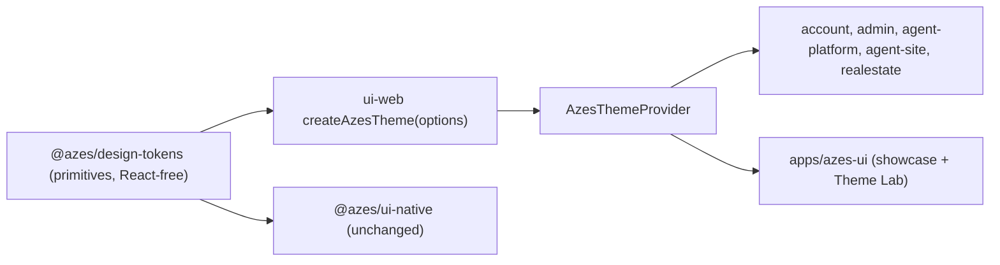

<!--
╔══════════════════════════════════════════════════════════════╗
║ AZES COMPANY
║ File: docs/styles/ARCHITECTURE.md
║ Author: AZES_COMPANY
║ Created: 2026-10-02
║ Updated: 2026-10-02
║ Purpose: Web styling architecture, data flow and token ownership
║ Layer: docs
╚══════════════════════════════════════════════════════════════╝
-->

# Architecture

## Styling engine

- Material UI 9.3.1 with Emotion 11.14 is the only component styling engine.
- Styles are written as `theme.components` overrides first, then the `sx` prop for one-off
  layout, then `styled()` for a reusable local piece. Plain CSS files are only for resets that
  MUI cannot express. Today that is `height: 100%` in each app's `styles.css`, plus the Next.js
  `globals.css`.
- `cssVariables` is on, with `colorSchemeSelector: 'data-azes-color-scheme'`. Both light and
  dark palettes are emitted as `--mui-*` CSS variables.

## Package responsibilities

| Package / app         | Owns                                                                                                                                                                 |
| --------------------- | -------------------------------------------------------------------------------------------------------------------------------------------------------------------- |
| `@azes/design-tokens` | Primitive values: color ramps, font families and scales, radius, sizing, breakpoints, motion, z-index, shadows. Semantic light/dark color maps (shared with native). |
| `@azes/ui-web`        | `createAzesTheme`, `AzesThemeProvider`, brand helpers, MUI augmentation, named MUI re-exports (catalog), the few AZES components (`Box`, `Stack`, `Text`, `Button`). |
| `apps/*` (product)    | Product UI built from `@azes/ui-web` exports. No direct `@mui/material` imports (ESLint `azes/no-mui-in-product-apps`).                                              |
| `apps/realestate`     | The documented SSR exceptions: `@mui/material-nextjs` and `InitColorSchemeScript`.                                                                                   |
| `apps/azes-ui`        | Showcase and Theme Lab. May deep-import `@mui/icons-material/*`. Never a dependency of another app.                                                                  |

## Token ownership

This is the single-source-of-truth table. A value lives in exactly one row.

| Concern                         | Lives in                           | Notes                                                        |
| ------------------------------- | ---------------------------------- | ------------------------------------------------------------ |
| Color ramps (teal, navy, gray…) | design-tokens                      | Shared with native                                           |
| Semantic light/dark colors      | design-tokens                      | Mapped into `colorSchemes.*.palette`                         |
| Palette roles (primary, etc.)   | MUI theme                          | Built from seeds and semantic colors                         |
| Font families, sizes, weights   | design-tokens                      | Primitives only                                              |
| Typography variants (h1…button) | MUI theme                          | No duplicated typography tokens                              |
| Spacing base                    | MUI theme (`spacing: 4`)           | `theme.spacing(n)` is the only spacing API on web            |
| Spacing primitive scale         | design-tokens                      | Native and existing `spacingScale` mapping only              |
| Density                         | MUI theme                          | Component defaultProps and sizes, not a second spacing scale |
| Radius                          | design-tokens, then `shape`        | `shape.radiusSm…radiusFull`, `theme.azesRadius`              |
| Control and container sizes     | design-tokens                      | Read by component overrides                                  |
| Breakpoints                     | design-tokens, then theme          | `xs sm md lg xl 2xl`                                         |
| Shadows / elevation             | MUI theme                          | Built from the `shadow` primitives into a 25-step ladder     |
| z-index, motion                 | design-tokens, then theme          | Mapped once in `createAzesTheme`                             |
| `themeToCss`, `toCssVariables`  | design-tokens (deprecated for web) | Unused on web. Keep for now; removal needs an approved task. |

## Boundaries (enforced)

- `ui-web` must not import `@azes/api`, `@azes/state` or business domains.
- `design-tokens` must not import React or MUI.
- Product apps must not import `@mui/material` directly.
- No app may depend on `apps/azes-ui`.
